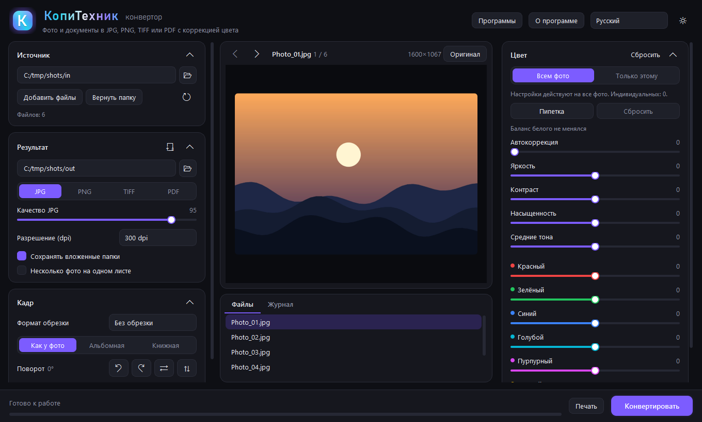
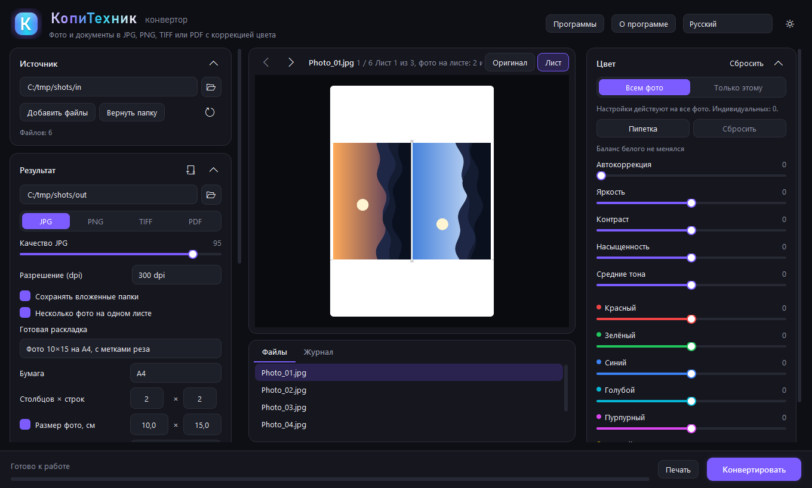
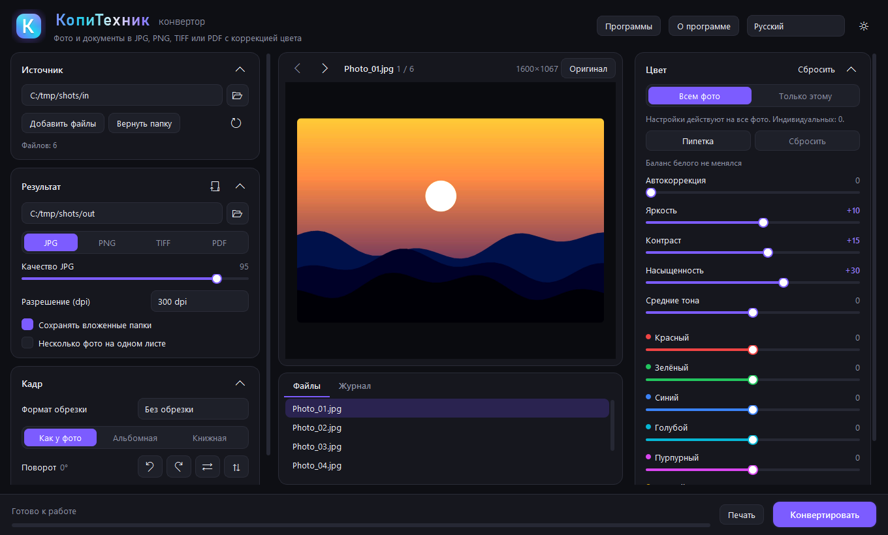
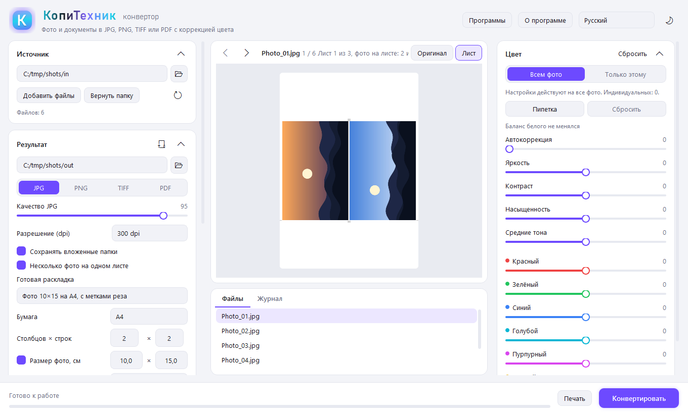

# KopiTehnik Converter

**Languages:** English · [Русский](README.ru.md) · [Deutsch](README.de.md) · [Español](README.es.md) · [Français](README.fr.md) · [Português](README.pt.md) · [Türkçe](README.tr.md) · [中文](README.zh.md)

**Free Windows software for photo labs and print shops: batch conversion, colour correction, print sheets, mouse cropping, a PDF editor with scan recognition, and print with preview. Driven by a person or by an AI agent.**

Convert photos and documents to JPG/PNG/TIFF/PDF, lay out multi-photo print sheets (10x15, ID photos, contact sheets), edit PDF and print. It is also an MCP server, so AI agents (Claude, Hermes, Cursor and others) can run the whole workflow through tools. Licence: AGPL-3.0.

| Main window | 10x15 sheet with cut marks |
|---|---|
|  |  |
|  |  |

*Screenshots were made with generated test images.*

## What is new in 3.0
- **Scan recognition inside the PDF editor.** Press "Recognize scan" (also for JPG, PNG, TIFF). The scan is straightened, cropped to the sheet and cleaned of noise and shadows; lines are recognized (Russian and English, locally, no internet or cloud, RapidOCR with PaddleOCR models bundled) and become ordinary editor blocks you can edit, move and add. While a line is untouched you see the scan image and the text sits as an invisible searchable layer; an edited line covers the old one in white.
- **Requisites check.** Highlights in yellow what looks doubtful: Russian tax and registration numbers by checksum, bank codes and accounts, impossible dates, amount in digits vs in words, Latin mixed with Cyrillic, a letter instead of a digit. The "Doubtful" button and Tab step through them, "All correct" clears the mark.
- **Saving text.** From the editor to Word (.docx, tables from scans become real Word tables), Excel (.xlsx, one sheet per page, numbers as numbers) or plain text.
- **Full-screen editor** (F11): Ctrl+wheel zoom, middle-button panning, "Fit width".
- **Mouse cropping:** drag over the photo to draw a frame with handles; a format (10x15 etc.) keeps the proportions. Arrow keys move the frame by 1 pixel (Shift: 10), Ctrl+arrows resize it.
- **Precise full-screen frame:** photo fills the window, zoom up to 24x, frame by mouse, arrows or pixel values.
- **Tilt** of ±45° (horizon fix) with automatic cropping of empty corners.
- **Undo and redo** (Ctrl+Z, Ctrl+Y) for frame, crop, tilt and rotation.
- **MCP:** fixed `print_files` with `color: "gray"` and `pdf_find_text` search in text written by `pdf_edit`.

## Why a photo lab needs it
A typical day: a customer brings a flash drive with phone HEIC, PSD, scans, Word and PDF. Everything must be made uniform, colour-corrected, laid out on 10x15 sheets or ID-photo sheets, given cut marks and sent to the printer. Converter does it in one program and one pass over the folder.
- **Any input:** JPG, PNG, WebP, BMP, GIF, TIFF, HEIC, PSD, PDF, SVG, TXT, HTML, XLSX, ZIP archives (RAR and 7z with 7-Zip or WinRAR installed), Word, PowerPoint and Excel through Microsoft Office or LibreOffice.
- **Colour:** auto-correction, white-balance picker, brightness, contrast, saturation, midtones, separate red, green, blue, cyan, magenta and yellow. The embedded ICC profile is honoured and converted to sRGB.
- **Print sheet:** ready layouts (10x15 and 9x12 photos on A4, 3x4, 3.5x4.5 and 4x6 ID photos, contact sheet), custom grid or size, margins, gap, copies, rotation to fit the cell, cut marks, captions.
- **Crop:** 3:2, 4:3, 5:4, 7:5, 1:1, 16:9, A4 and custom size in cm, mm or inches, mouse frame, tilt, rotate, mirror.
- **Print:** sheet preview on paper, printer choice and its properties, paper A3, A4, A5, A6, 10x15, 13x18, 15x21, 20x30, Letter, margins, copies, page range, colour or B/W, "fit", "fill without margins" or real size by dpi.
- **PDF editor:** insert text, pick a line or paragraph and fix or move it, erase an area, recognize a scan (locally), save text to Word or Excel. The source file is never changed.
- **Batch processing** in several threads and a command line: `Converter.exe --convert <folder> <output>`.

## Control by AI agents (MCP)
The program runs as an **MCP server**: an AI agent gets every function as a tool with text parameters. No window or vision is needed: results are checked by numbers (sizes, brightness, contrast), PDF text and, if wanted, a preview picture. For example: "lay out the photos from the folder on 10x15 sheets, check brightness, count the sheets and print after my confirmation".

- stdio transport. The server runs only on your computer and listens to nothing on the network.
- Works with Claude Desktop, Claude Code, Hermes Agent, Cursor, Cline and any MCP client.
- Tools: `app_info`, `list_files`, `inspect_file`, `convert`, `make_sheet`, `preview`, `pdf_info`, `pdf_get_text`, `pdf_find_text`, `pdf_edit`, `pdf_pages`, `list_printers`, `print_files`.
- Printing is safe: `print_files` has `dry_run` (only counts sheets) and `printer: "pdf"` (writes a file). Source files are never changed.

Connect with `Converter.exe --mcp`. A ready setup is in About, "Connect an AI agent". Details and examples for each client: [MCP.md](MCP.md).

## Install
**[Download KopiTehnik-Converter-Setup.exe](https://github.com/ildargiv/kopitehnik-converter/releases/latest)** (Releases): no administrator rights, with shortcuts, uninstall from "Apps". New versions are announced at https://vk.ru/icc_profil. The program checks GitHub at start and offers an update; the downloaded installer is verified against the SHA-256 of the release.

The interface is available in 8 languages (Russian, English, Spanish, German, French, Portuguese, Turkish, Chinese; the Windows language is detected automatically, English is the default) with dark and light themes. The program name is translated together with the interface.

### Verify the file
The installer is built by GitHub Actions from the open source ([workflow](.github/workflows/release.yml)); the release carries `SHA256SUMS.txt` and a build attestation. Check the hash: `certutil -hashfile KopiTehnik-Converter-Setup.exe SHA256`. The file is not signed yet (a free SignPath application is in preparation), so SmartScreen may show "Unknown publisher": "More info", then "Run anyway".

## Run from source
Python 3.10 or newer is required.

    pip install PySide6 pillow pillow-heif openpyxl pymupdf rapidocr opencv-python
    python app.py

## Build the exe
    pip install pyinstaller
    pyinstaller converter.spec        # result in dist\Converter.exe

A full build with its own LibreOffice (works on computers without Office; folder about 850 MB, zip about 380 MB):

    python tools/make_full.py [LibreOffice folder]   # result in dist\Converter-full and dist\Converter-full.zip

Without an argument the LibreOffice installed on this computer is used. A portable LibreOffice also works: give its `App\libreoffice` folder.

## Structure
- `core/loaders.py` reads files of any format into pages; `core/office.py` finds Microsoft Office and LibreOffice and turns documents into PDF
- `core/imaging.py` colour, rotation, crop, saving; `core/sheet.py` several photos on one sheet
- `core/batch.py` file search, archives, multi-threaded batch, PDF output
- `ui/main_window.py` main window; `ui/programs.py` programs window; `ui/printing.py` printing; `ui/pdf_editor.py` PDF editor; `ui/crop_dialog.py` precise frame
- `ui/widgets.py`, `ui/theme.py`, `ui/i18n.py` (+ `ui/i18n_<lang>.py`) widgets, theme, interface texts
- `core/ocr.py` scan preparation and recognition (RapidOCR); `core/requisites.py` checks of tax numbers, dates and amounts; `core/textexport.py` saving text to Word, Excel and txt
- `tools/make_test_scan.py` makes an invented contract scan to test recognition
- `core/mcp_server.py`, `core/mcp_tools.py`, `core/pdftools.py`, `core/printjob.py` MCP server, its tools, PDF editing and windowless printing
- `tools/make_full.py` full build with LibreOffice

### Adding a language
Create `ui/i18n_<code>.py` with `TEXTS = {...}` (copy `ui/i18n_de.py` and translate the values; missing keys fall back to English), then add the code and its native name to `LANGUAGES` in `ui/i18n.py`. Set `app_title` to the translated program name.

## Licence
Copyright (C) Ildar Gaisin (Gaisin Ildar Vilsurovich). Free software under the GNU Affero General Public License v3 (file `LICENSE`): free to use, study, modify and distribute; the source must stay open. Third-party licences: `THIRD_PARTY_NOTICES.txt`.

## Author
**Ildar Gaisin (Gaisin Ildar Vilsurovich)**, developer of KopiTehnik Converter, a photo lab and professional printing company.
News, releases and contact: VK group https://vk.ru/icc_profil
